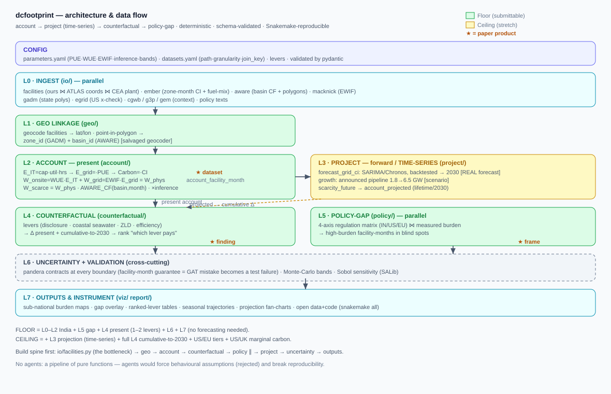

# Methodology

This page follows Section 4 of the paper and names the module that implements each step. Every assumed number
lives in [`dcfootprint/config/parameters.yaml`](../dcfootprint/config/parameters.yaml) and is validated on load
(`settings.py`, pydantic). Nothing numeric is hard-coded in the modules.

## Design rules

- The atomic unit is the **facility-month**. Each resource keeps its native spatial unit (grid zone for
  electricity and carbon, river basin for water), and the facility is the join key.
- Regional data are applied to facilities but never forecast at the facility level.
- Every hand-over between stages is checked by a data contract (`validation/schemas.py`, pandera).
- The pipeline is deterministic: two clean runs give identical outputs.

## Layers

| Layer | Step | Module |
|---|---|---|
| L0 | Ingest: facilities, Ember, GEM, AWARE, Electricity Maps, CEA | `io/` |
| L1 | Spatial linkage: facility and power plant → grid zone (state or country) and AWARE basin | `geo/join.py`, `geo/generation_basins.py` |
| L2 | Monthly account: energy, carbon, physical and scarcity-weighted water | `account/` |
| L2.5 | Calibration against independent totals | `account/calibrate.py` |
| L3 | Forecasts and 2030/2050 scenarios | `project/` |
| L4 | Incidence matrices, basin budgets | `geo/incidence.py`, `project/recharge.py` |
| L5 | Policy registry and regulatory gap | `policy/` |
| L6 | Routing bound | `routing/` |
| L7 | Levers, harm scorecard, siting | `counterfactual/levers.py`, `decisions/` |
| L8 | Uncertainty: Monte Carlo and Sobol | `uncertainty/monte_carlo.py` |
| L9 | Reports and figures | `viz/figures.py`, `pipeline.py`, `regions.py` |

`pipeline.py` runs India through all layers. `regions.py` runs the US (facility level) and the EU (country level).

## Account (paper Section 4.2 to 4.5)

For facility $f$ in month $m$, supplied by zone $z$ (an Indian or US state, or an EU country):

$$E^{IT}_{f,m} = C_f \, u_f \, h_m \qquad (1)$$

$$E^{grid}_{f,m} = E^{IT}_{f,m} \, \mathrm{PUE}_f \qquad (2)$$

$$CO_{2,f,m} = E^{grid}_{f,m} \, CI_{z,m} \qquad (3)$$

$$W^{on}_{f,m} = \mathrm{WUE} \, E^{IT}_{f,m} \qquad (4)$$

$$W^{off}_{f,m} = E^{grid}_{f,m} \sum_k s_{z,m,k} \, \mathrm{EWIF}_k \qquad (5)$$

$$W^{scarce}_{f,m} = W^{on}_{f,m} \, CF_{b,m} + E^{grid}_{f,m} \sum_k s_{z,m,k} \, \mathrm{EWIF}_k \, \overline{CF}^{gen}_{z,m,k} \qquad (6)$$

where $C_f$ is installed capacity, $u_f$ utilisation, $h_m$ hours in the month, $CI_{z,m}$ the grid carbon
intensity, $s_{z,m,k}$ the share of fuel $k$ in the zone's generation, $\mathrm{EWIF}_k$ the water consumed per
MWh generated with fuel $k$ (Macknick et al., 2012), $CF_{b,m}$ the AWARE 2.0 scarcity factor of the facility's
basin, and $\overline{CF}^{gen}_{z,m,k}$ the capacity-weighted factor of the basins that hold the zone's plants
of fuel $k$. Physical water ($W^{on} + W^{off}$) and scarcity-weighted water (m³-eq) are reported separately.

**Carbon basis.** India uses the consumption-based, import-adjusted intensity of the five regional grids from
Electricity Maps (life-cycle). The US and EU use Ember generation-based intensities (direct). The India
generation-basis rerun is in [`results/generation_basis_check/`](../dcfootprint/results/generation_basis_check/).

**EU.** Facility data are confidential, so the measured energy and water input reported by 21 member states
replace equations (1), (2) and (4). IT energy uses the EU-average PUE of 1.36.

### Parameters (paper Table 2)

| Parameter | Default | Monte Carlo band |
|---|---|---|
| Utilisation, colocation / hyperscale | 0.45 / 0.70 | 0.30–0.65 / 0.55–0.85 |
| PUE, colocation / hyperscale | 1.6 / 1.2 | 1.4–1.9 / 1.1–1.4 (operator values override where disclosed) |
| WUE (L/kWh IT) | 1.9 | 0.7–2.5 |
| EWIF coal / gas / nuclear (L/MWh) | 2,600 / 750 / 2,540 | coefficient band |
| EWIF hydro / solar / wind (L/MWh) | 17,000 / 100 / 0 | hydro multiplier 0–1 |
| Inference share of operational load | 0.85 | 0.80–0.90 (scoping only) |
| EU PUE | 1.36 | measured |

## Calibration and uncertainty (Section 4.6)

- Totals are compared with CEEW/JLL (India operational capacity, 1.5–1.8 GW), LBNL (US energy, 176 TWh) and the
  estimated number of EU datacenters. Calibration checks totals, not their spatial distribution.
- 4,000 Monte Carlo draws, each assumed parameter on a triangular distribution (mode = default, support = band).
  For the EU only the off-site water coefficients and the hydro multiplier vary.
- First-order Sobol indices $S_i = \mathrm{Var}[\mathrm{E}(Y \mid X_i)] / \mathrm{Var}(Y)$, estimated from the
  Monte Carlo sample with 40 quantile bins per parameter.

## Regulatory gap (Section 4.7)

`policy/registry.py` merges three sources into one 26-entry registry: the 15 collected policy documents
(`config/policy_sources.csv`), the 7 legal rules applied in the analyses (`config/legal_constraints.csv`), and
the closest instrument for each axis. `policy/gap.py` derives the four-axis matrix (carbon intensity, marginal
carbon, scarcity-weighted water, AI-inference attribution) from the registry rather than coding it by hand.

Legal limits applied in siting and routing:

| Region | Rule | Effect in the model |
|---|---|---|
| Rajasthan | zero liquid discharge | on-site water reduced by 92% |
| Gujarat | ≥51% renewable supply | carbon reduced accordingly |
| Ireland | ≥80% additional renewable supply | carbon reduced accordingly |
| Germany | PUE ≤ 1.2 for new facilities | efficiency cap |
| Noord-Holland | ban on new sites ≥70 MW | cell excluded, no added load |
| Minnesota | permit conditions above 100 Mgal/yr | recorded; no numeric effect |
| EU-wide | PUE and WUE reporting | disclosure only |

## Decision analyses (Section 4.8)

- **Levers** (`counterfactual/levers.py`): zero liquid discharge (92% of on-site water recycled), an efficiency
  standard (PUE ≤ 1.3, WUE ≤ 0.7 L/kWh) and coastal seawater cooling (WUE 0.1 L/kWh, coastal Indian cities).
  Each lever changes parameters, recomputes the account and compares it with the baseline.
- **Harm scorecard** (`decisions/scorecard.py`, `decisions/equity.py`): a facility is flagged when its
  scarcity-weighted water is in the top quarter of its region and its basin factor is in the top 40%. Each flagged
  facility gets the lever that saves the most water within its state's rules. India adds the CGWB
  groundwater-extraction stage.
- **Siting** (`decisions/siting.py`): a hypothetical 50 MW colocation facility is scored in every state × basin
  cell on four criteria (scarcity-weighted water, carbon, rise in peak basin deficit, fossil share), rescaled to
  [0, 1]. 500 Dirichlet weight vectors give scores $S_c(\mathbf{w})$, and cells are ranked by minimax regret
  $R_c = \max_{\mathbf{w}} [S_c(\mathbf{w}) - \min_{c'} S_{c'}(\mathbf{w})]$. The 2030/2050 version adds the
  Aqueduct 4.0 water-stress score (seven scenarios) and official grid-carbon paths.
- **Routing** (`routing/lyapunov.py`, `routing/agents.py`): 30% of each facility's monthly IT energy can move,
  sites are capped at 90% utilisation, and demand is perturbed by 5% Gaussian noise over 10 seeds. Basin budgets
  come from AWARE (water remaining after human and environmental use), and a queue tracks each basin's overdraft.
  A Lyapunov drift-plus-penalty controller is compared with a static allocation, a greedy rule, a version with
  perfect carbon knowledge and an offline full-year oracle. Each month's linear programme is solved by price
  decomposition among grid, basin and facility agents, which matches the centralised HiGHS solution to within
  1.7 × 10⁻¹⁴ in 56 tests. **The routing analysis is a diagnostic bound on stylised demand, not a deployable
  router.** It is not run for the EU (no site locations).

## Forecasting (Section 4.9)

The routing controllers use a one-month-ahead forecast of each state's carbon intensity, chosen by a rule fixed
before any comparison (lowest mean error over 2022–2023 among seasonal naive, bottom-up SARIMA(1,1,1)(1,0,1,12)
and MinT reconciliation, provided it beats seasonal naive). A separate benchmark
([`runs/forecast_benchmark_2026-09-28/`](../runs/forecast_benchmark_2026-09-28/)) compares seasonal naive, two
SARIMA specifications, Chronos-2, TimesFM 2.5, xLSTM (5 seeds) and the LLM multi-agent forecaster
([`runs/nexus_llm_2026-09-28/`](../runs/nexus_llm_2026-09-28/)) on 66 account-zone series, with a 12-month
holdout and rolling origins in December 2022, 2023 and 2024 (189 windows).
